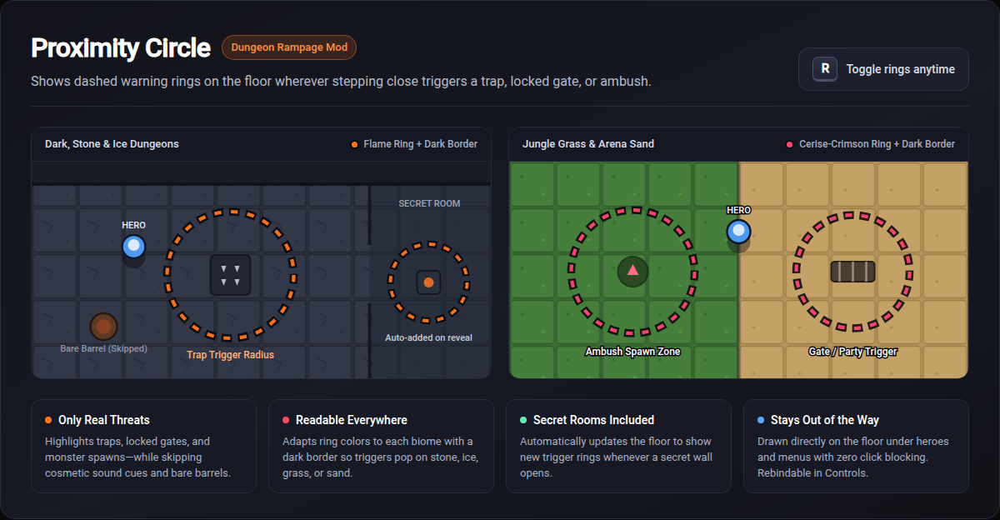

# Proximity Circle

<!-- drh:show -->
Shows clear warnings on the dungeon floor, directly on breakable trap objects, and in a Dungeon Rampage-styled HUD card so you always know what nearby triggers will unleash—and whether they have already fired.

- **Step-triggered hazards (etched dungeon rings):** Restrained mineral-toned floor markings (Aged Terracotta traps, Tarnished Brass ambushes, Muted Plum-Burgundy Boss double-seals, Weathered Verdigris gates) with distinct CVD-safe shapes, active ember pop-out when stepped on or firing, and faded ash traces once cleared.
- **Breakable trap objects (world-space anti-affordance signifiers):** Destructible barrels, cages, statues, eggs, and huts that unleash enemies, mini-bosses, or traps show an overhead prohibition badge with a skull / crowned Boss skull / hazard icon (rattling subtly when you get close), an iron containment collar around their base, and a muted crimson/burgundy sprite rim—so they clearly read *"do not break"* instead of *"shiny loot"*.
- **Native Trap Inspector HUD:** Sits cleanly in the top-right HUD rail (never blocking enemies ahead of you) with carved DRH wood/gold chrome, outcome-first rows, and live status chips (**STEP OFF!**, **NO BREAK**, **<N> ALIVE**, **FIRING!**, **ARMED**, **CLEARED**).
- **Only real threats:** Skips cosmetic camera/sound cues, secret walls, harmless scenery, and objects you are supposed to smash to stop spawners.
- **Updates as you explore:** Automatically marks newly revealed areas when secret rooms open.

## Controls

- Press **R** to show or hide all rings, object highlights, and the HUD (you can rebind this key under **CONTROLS** in the settings menu).
<!-- /drh:show -->
